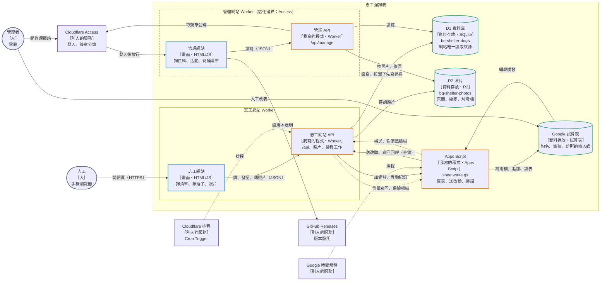
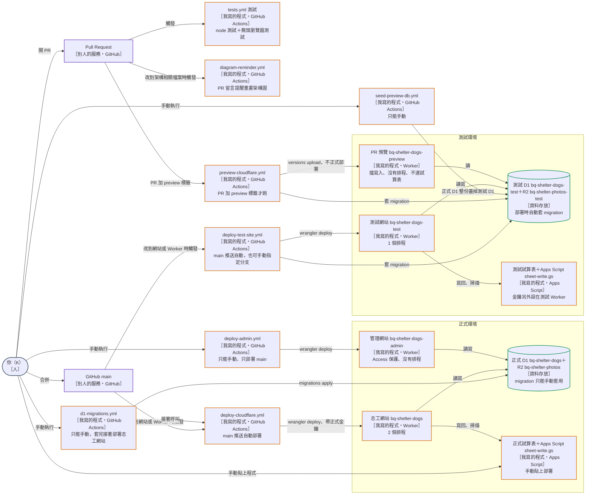
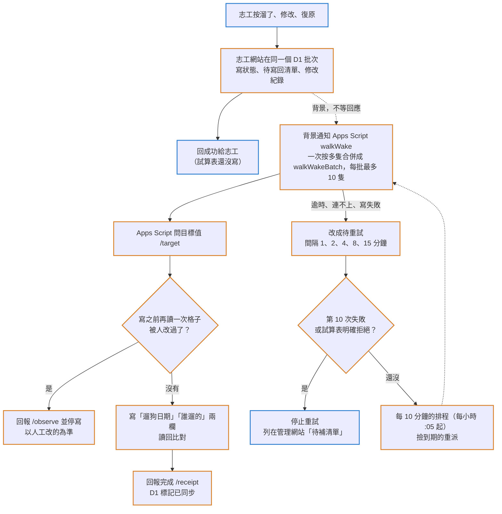
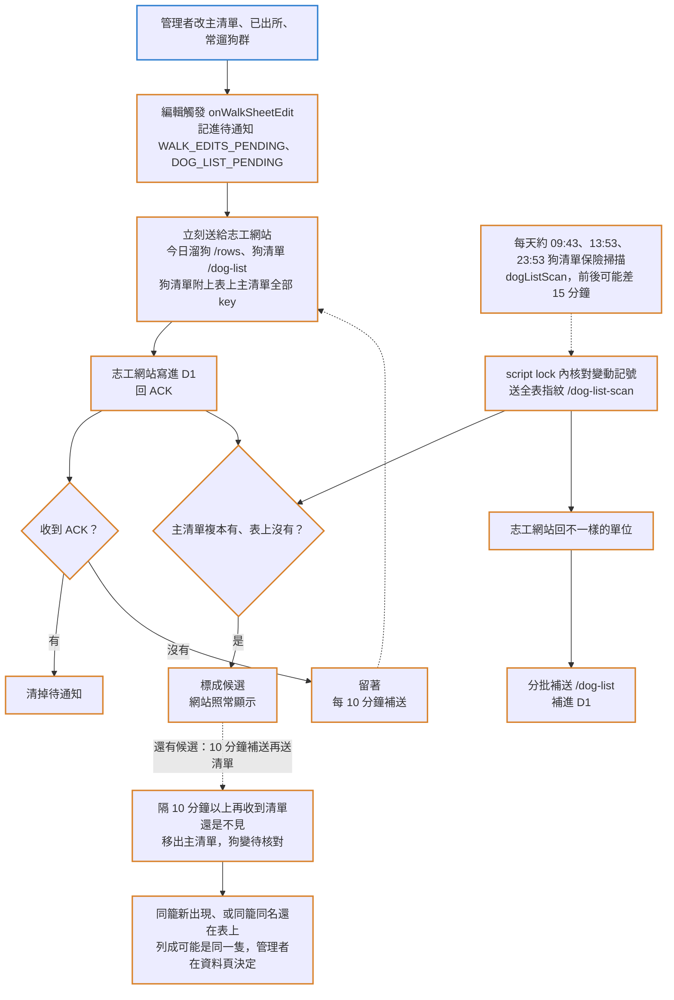
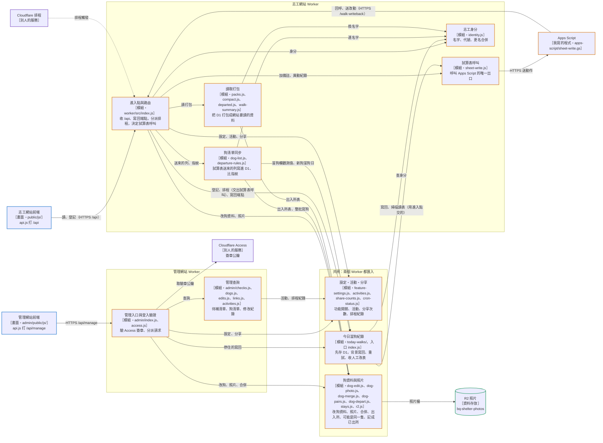
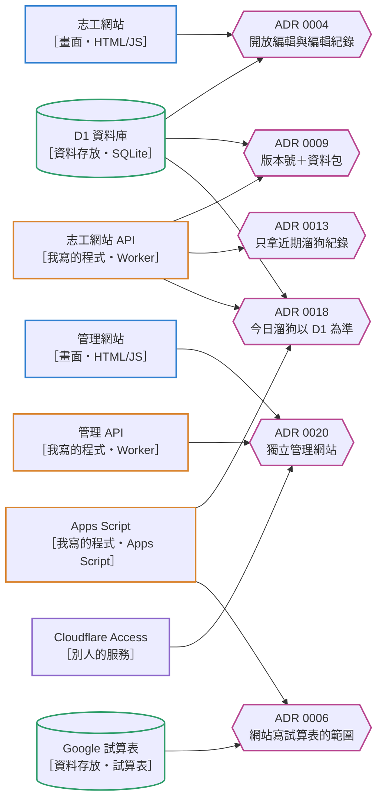
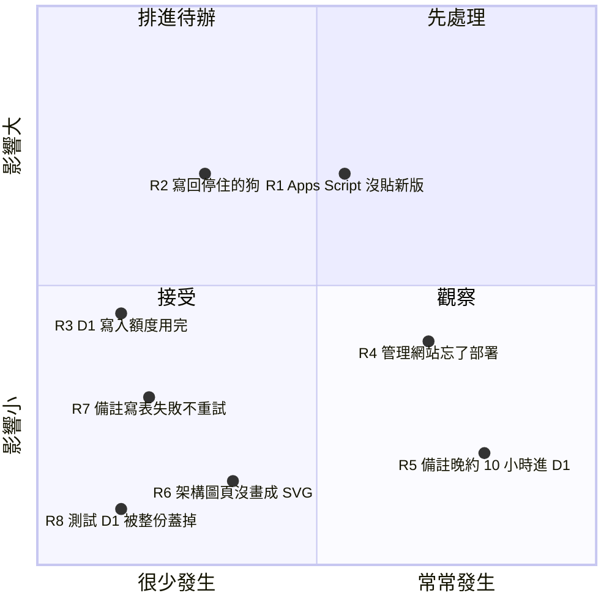

# 架構圖：志工溜狗表

> 核對日：2026-10-30｜依據 commit：`37b8509`
> 改到圖上的元件、連線、排程或部署方式時，在同一個 PR 更新這份檔案。規則見 agent-hub `docs/rules/architecture-diagrams.md`。
> 名稱、排程時間、重試次數、端點跟程式不一致時 `scripts/diagram-facts.test.mjs` 會失敗；PR 改到架構相關檔案卻沒改對應段落，「架構圖重畫提醒」會在 PR 留言。管理網站「系統架構圖」頁也是從這份檔案產生。

一句話：收容所志工用手機看狗清單、登記溜狗；管理者用管理網站改狗資料，也照舊在 Google 試算表改狗清單。網站只讀 Cloudflare D1，試算表的改動由 Apps Script 送進 D1，網站登記的溜狗再寫回試算表。
技術：Cloudflare Worker、D1、R2、Cloudflare Access、Apps Script、Google 試算表、GitHub Actions

## 主圖（容器）｜志工溜狗表｜正式環境

- 志工網站和 API 是同一個 Worker `bq-shelter-dogs`：網頁是 `public/` 的靜態檔，`/api/*`、`/photos/*` 先進 Worker（`wrangler.jsonc:8-16`）；`/api` 去掉前綴後分派，照片從 R2 讀（`worker/src/index.js:795-813`）。
- 網站讀資料一律讀 D1、照片讀 R2，不讀試算表；`worker/src/sheet-read.js` 只剩拆名字的函式（`worker/src/sheet-read.js:1-9`）。
- 按溜了、修改、復原：先在同一個 D1 批次寫狀態、待寫回清單與修改紀錄（`worker/src/today-walks/version.js:81-82`），回成功給志工後才在背景寫回試算表（`worker/src/index.js:552-557`），細節見「流程｜網站登記寫回試算表」。
- 例外：加備註、新增異動紀錄是 Worker 同步請 Apps Script 直接寫表，不先存 D1，失敗就回錯誤給志工、不重試；寫成功後 D1 只多一筆修改紀錄（`worker/src/index.js:565-581`）。
- 正式環境裡，志工網站對試算表的呼叫都經過 `callSheet`，動作只有 note、log、walkWake、walkWakeBatch、walkScan（`worker/src/sheet-write.js:6`、`worker/src/sheet-write.js:25-47`）。
- Apps Script 打志工網站的 `/api/walk-writeback/` 六個端點（target、receipt、observe、rows、dog-list、dog-list-scan），帶 `X-Sheet-Write-Key` 標頭；Worker 驗金鑰，PR 預覽版一律拒收（`apps-script/sheet-write.gs:61-72`；`worker/src/index.js:836-843`）。
- 排程：Worker 每 10 分鐘重試寫回；09:23、13:23、23:23 掃描今日溜狗，每天第一次順便清修改紀錄，每月 1 日清照片垃圾桶（`wrangler.jsonc:41-43`；`worker/src/index.js:26-30`、`worker/src/index.js:769-782`）。Apps Script 排程：每 10 分鐘補送待通知，約 09:43、13:53、23:53 狗清單保險掃描（`apps-script/sheet-write.gs:305-315`）。時間細節見「一天裡的排程」。
- 管理網站是另一個 Worker `bq-shelter-dogs-admin`，跟志工網站綁同一個正式 D1 與 R2（`wrangler.admin.jsonc:9-26`；`wrangler.jsonc:19-26`）。每個請求先驗 Access 簽章，公鑰向 Access 取（`worker/src/admin/index.js:61-66`；`worker/src/admin/access.js:28`）。
- 管理網站不連試算表：程式裡沒有 `callSheet`，只碰 D1、R2；試算表與 Apps Script 只放連結給人點（`worker/src/admin/index.js:67-122`；`worker/src/admin/links.js:1-13`）。
- 管理網站「網站更新」頁在瀏覽器直接讀公開 repo 的 GitHub Releases，不經 Worker；管理網站 CSP 的 connect-src 因此多放 api.github.com（`admin/public/js/api.js:20-22`；`worker/src/admin/index.js:17-19`）。
- 沒畫：GitHub Actions 的 `r2-thumbs` 用 `ADMIN_KEY` 打志工網站 `/api/admin/` 補縮圖（`worker/src/index.js:828-835`；`.github/workflows/r2-thumbs.yml:1-9`）。

## 各類資料的流向

- 網站讀資料一律讀 D1（照片讀 R2），不讀試算表；試算表是人工改狗清單的地方，改動由 Apps Script 送進 D1（`worker/src/index.js:795-813`；`apps-script/sheet-write.gs:1-4`）。
- 今日溜狗・網站登記：志工按溜了、修改、復原，先存 D1 的狀態與待寫回清單，再背景寫回試算表「遛狗日期」「誰遛的」兩欄並讀回確認（`worker/src/today-walks/version.js:81-82`；`apps-script/sheet-write.gs:132-154`）。見「流程｜網站登記寫回試算表」。
- 人工改表：管理者改主清單、已出所、常遛狗群，Apps Script 記下待通知送給志工網站寫進 D1，ACK 才清（`apps-script/sheet-write.gs:317-343`；`worker/src/index.js:848-873`）。D1 裡是試算表內容的複本。見「流程｜試算表改動回到 D1」。
- 備註、異動紀錄・網站新增：例外，不先存 D1。志工網站等 Apps Script 追加完才回志工，失敗不重試（`worker/src/index.js:565-581`；`apps-script/sheet-write.gs:48-55`）。程式寫表不會觸發編輯觸發，所以要等下一次狗清單保險掃描才進 D1，最久約 10 小時（`apps-script/sheet-write.gs:275`）。
- 照片：志工（照片開關開啟時）或管理者上傳原圖＋前端做好的縮圖，存 R2，D1 記主照片指標；換掉的先備份到 `trash/`，照片垃圾桶每月 1 日清 30 天以上的（`worker/src/dog-photo.js:64-91`；`worker/src/r2.js:8-10`）。沒縮圖時網站顯示原圖，補縮圖要手動跑 r2-thumbs（`.github/workflows/r2-thumbs.yml:1-5`）。
- 狗資料（介紹、休養、固定照顧、出入所）、活動、功能開關、分享次數：志工（看功能開關）或管理者寫，只存 D1、不寫回試算表；狗資料寫入前先比對版本（`worker/src/dog-edit.js:17-21`、`worker/src/conditional-batch.js:5-11`；`worker/src/feature-settings.js:39`；`worker/src/share-counts.js:7-13`）。
- 修改紀錄跟著每個寫入動作同一批寫進 D1，來源分志工、試算表、管理者三種（`worker/src/editlog.js:64-84`）；保留 14 天（合併狗快照永久保留），每天 09:23 那次排程清一次（`worker/src/editlog.js:97-102`）。

## 一天裡的排程

- Cloudflare 排程用 UTC，下面都換成台灣時間（UTC+8）。志工網站 Worker 有 2 個排程：`5-59/10 * * * *` 與 `23 1,5,15 * * *`，改這裡要一起改程式裡的常數（`wrangler.jsonc:37-43`；`worker/src/index.js:26-27`）。
- 每 10 分鐘（每小時 :05 起）寫回重試：撿到期、中斷的寫回工作重派，每輪最多 10 隻（`worker/src/today-walks/dispatch.js:35-56`）。
- 09:23、13:23、23:23 今日溜狗保險掃描：Worker 呼叫 Apps Script 讀主清單比指紋，不一樣才找出不同的狗（`worker/src/today-walks/index.js:43-46`；`worker/src/today-walks/scan.js:15-37`）。
- 每天第一次掃描（09:23）這次也清 14 天前的修改紀錄（合併快照保留）；每月 1 日這次順便清照片垃圾桶（30 天以上）（`worker/src/index.js:28-30`、`worker/src/index.js:777-781`；`worker/src/r2.js:186`）。
- Apps Script 時間觸發（專案時區 Asia/Taipei）：flushWalkEdits、flushDogList 每 10 分鐘補送待通知，起點由 Google 決定；dogListScan 在約 09:43、約 13:53、約 23:53 做狗清單保險掃描，Google 只保證在那個小時內，前後可能差 15 分鐘（`apps-script/sheet-write.gs:305-315`）。
- 兩種保險掃描跟 Worker 錯開 20～30 分鐘，方向相反：今日溜狗是 Worker 呼叫 Apps Script 讀表，狗清單是 Apps Script 把指紋送給 Worker（`apps-script/sheet-write.gs:498-523`）。
- 日界線：今日溜狗用台灣日期，00:00 換日；寫入預算以 UTC 日期算，台灣 08:00 重置（`worker/src/today-walks/shared.js:16`、`worker/src/today-walks/shared.js:18`）。
- 測試網站只有每 10 分鐘那條；PR 預覽、管理網站沒有排程（`wrangler.test-site.jsonc:38-40`；`wrangler.preview-db.jsonc:9`）。每週一 09:00 的版本號整理（release-please）不碰資料（`.github/workflows/release-please.yml:9-11`）。

## 上線圖｜志工溜狗表

- 志工網站：main 推送且改到 `public/`、`worker/src/`、`wrangler.jsonc`、`migrations/` 等才自動部署，也可手動；只准 main（`.github/workflows/deploy-cloudflare.yml:13-31`、`.github/workflows/deploy-cloudflare.yml:44-46`）。部署前正式 D1 有還沒套的 migration 就停，部署時帶正式金鑰，部署後打正式站 API 檢查（`.github/workflows/deploy-cloudflare.yml:93-119`）。
- 正式 D1 的 migration 只能手動按「套用 D1 migration」，套完接著呼叫上面的部署；不會順便部署管理網站（`.github/workflows/d1-migrations.yml:1-14`、`.github/workflows/d1-migrations.yml:50-54`）。
- 管理網站只能手動部署、只部署 main；改到兩站共用的程式時，志工網站自動部署，管理網站要另外按（`.github/workflows/deploy-admin.yml:1-15`、`.github/workflows/deploy-admin.yml:24-27`）。部署時 `wrangler.admin.jsonc` 的 build 先產生架構圖頁等共用檔（`wrangler.admin.jsonc:14`）。
- 測試網站：main 推送時跟正式版一起部署，也可手動指定分支；部署前自動對測試庫套 migration，不帶金鑰，保留測試 Worker 上原有的（`.github/workflows/deploy-test-site.yml:1-27`、`.github/workflows/deploy-test-site.yml:68-81`）。只有每 10 分鐘那個排程（`wrangler.test-site.jsonc:38-40`）。
- PR 預覽：PR 加 preview 標籤、改到網站或 Worker 才跑；先驗證只綁測試 D1、測試 R2、只有 WALKER_KEY，再自動套 migration，用 versions upload 上傳預覽版本並帶 PREVIEW 變數擋寫入（`.github/workflows/preview-cloudflare.yml:15-23`、`.github/workflows/preview-cloudflare.yml:37-40`、`.github/workflows/preview-cloudflare.yml:66-90`）。PR 預覽沒有排程（`wrangler.preview-db.jsonc:9`）。
- 測試網站與 PR 預覽共用測試 D1；「準備預覽資料庫」會把正式 D1 整份蓋掉測試 D1，測試網站上的實測資料也會不見（`wrangler.test-site.jsonc:1-3`；`.github/workflows/seed-preview-db.yml:1-17`）。
- 正式與測試 Worker 名稱、D1、R2：`wrangler.jsonc:8-26`、`wrangler.admin.jsonc:9-26`、`wrangler.test-site.jsonc:10-26`、`wrangler.preview-db.jsonc:6-12`。
- Apps Script 沒有自動部署：`apps-script/sheet-write.gs` 由 K 貼到 Google 部署成網頁應用程式，正式、測試各一份（`apps-script/sheet-write.gs:1-8`）；測試 Worker 的試算表金鑰另外設定，workflow 不帶（`.github/workflows/deploy-test-site.yml:7-8`）。
- 沒畫：r2-thumbs（手動補縮圖到正式 R2）、pr-guard（重複 PR 提醒）、release-please（版本號）、`scripts/dog-faces.py`（小遊戲的臉部位置：K 在本機手動跑，讀正式站 `/api/dogs` 和照片，模型執行時從 Hugging Face 下載，產生 `public/data/dog-faces.json` 再開 PR，#795）。

## 流程｜網站登記寫回試算表

- 志工網站 Worker `bq-shelter-dogs` 先在一個 D1 批次寫好狀態、請求、待寫回清單、溜狗紀錄、修改紀錄（`worker/src/today-walks/version.js:81-82`），回應之後才用 `waitUntil` 在背景派送（`worker/src/index.js:552-557`）。
- 派送：單隻用 walkWake，多隻合併成 walkWakeBatch，每批最多 10 隻（`worker/src/today-walks/dispatch.js:30-33`、`worker/src/today-walks/dispatch.js:112-118`）；Apps Script 收到後走 `writeLatestWalk`（`apps-script/sheet-write.gs:45-47`）。
- Apps Script（`apps-script/sheet-write.gs` 的 writeLatestWalk）：先問 /target；寫前再讀一次，發現人工改過就 /observe 並停寫；寫兩欄、讀回比對，一致才 /receipt（`apps-script/sheet-write.gs:132-154`）。Worker 收 /target、/receipt、/observe 在 `worker/src/index.js:858-880`。
- 失敗就改成待重試，間隔 1、2、4、8、15 分鐘；第 10 次失敗、或試算表明確拒絕（金鑰、試算表 ID、權限）就停，不再重派（`worker/src/today-walks/dispatch.js:15-22`、`worker/src/today-walks/dispatch.js:146-155`；`worker/src/sheet-write.js:49-55`）。停住的狗列在管理網站「待補清單」（`worker/src/admin/index.js:117`）。
- 每 10 分鐘的排程撿到期的、中斷超過 60 秒的派送重派，每輪最多 10 隻（`worker/src/today-walks/dispatch.js:35-56`）。重試每天另有寫入上限，用完延到隔天（`worker/src/today-walks/dispatch.js:24-27`；`wrangler.jsonc:30-31`）。
- 例外：加備註、新增異動紀錄不走這條，是 Worker 同步請 Apps Script 直接寫表，失敗不重試（`worker/src/index.js:565-581`）。

## 流程｜試算表改動回到 D1

- 編輯觸發只處理主清單、已出所、常遛狗群三個分頁，改到的單位記進待通知再立刻送（`apps-script/sheet-write.gs:317-343`）。今日溜狗走 /rows（`apps-script/sheet-write.gs:357-381`），狗清單（主清單、已出所、常遛狗群、異動紀錄）走 /dog-list（`apps-script/sheet-write.gs:457-483`）。
- 待通知分別存在 Apps Script 指令碼屬性 WALK_EDITS_PENDING、DOG_LIST_PENDING，收到 ACK 才清；送不出去就留著，每 10 分鐘補送（`apps-script/sheet-write.gs:278`、`apps-script/sheet-write.gs:441`；`apps-script/sheet-write.gs:311-313`）。
- 志工網站收 /rows、/dog-list、/dog-list-scan（`worker/src/index.js:848-873`）；/rows 要 `D1_WALK_NOTIFY` 開著才收進 D1，否則回 ack false 讓 Apps Script 留著（`worker/src/index.js:861-872`；`wrangler.jsonc:32-33`）。
- 狗清單保險掃描：每天約 09:43、13:53、23:53 狗清單保險掃描，先送全表指紋，志工網站回不一樣的單位，再分批補送（`apps-script/sheet-write.gs:498-523`；`worker/src/dog-list.js:324-351`）。
- 程式寫表不會觸發編輯觸發：網站新增的備註、異動紀錄，要等下一次保險掃描才進 D1，最久約 10 小時（`apps-script/sheet-write.gs:275`）。
- 列消失（#771，ADR 0025）：送狗清單、保險掃描送指紋都附上表上主清單的全部 key。主清單複本有、表上沒有的列先標成候選（`v3_sheet_main.missing_at`），又出現就取消；隔 10 分鐘以上再收到清單還是不見才確認，移出主清單，狗的資料不刪、管理網站顯示待核對。志工網站回「還有候選」時，Apps Script 的 10 分鐘補送沒有待送也再送一次清單（指令碼屬性 DOG_LIST_CANDIDATES）。一次請求最多處理 10 個；表上一次少一半以上的狗不當成消失（`worker/src/dog-list.js` 的 `reconcileMissing`；`apps-script/sheet-write.gs` 的 `flushDogList`、`dogListScan`）。
- 暫住列（#772，ADR 0025）：沒編號、犬名用括號包起來、括號裡是主清單上一隻有編號的狗（例「(皮蛋）」），不建狗，存成暫住紀錄 `v3_sheet_stays`（哪一隻、暫住哪一籠），修改紀錄記暫住開始。在所資料包照舊把這一列接在狗清單後面送出，志工網站合到那隻狗。暫住列消失照上一點的候選規則確認，確認後刪掉暫住紀錄、記暫住結束（`worker/src/dog-list.js` 的 `applyStay`、`reconcileMissing`）。
- 搬籠清舊列（ADR 0025）：沒編號的列，犬名和備註（不是空白）都跟主清單上一隻有編號的狗相同，而且有編號那列這次還在表上，是搬籠時舊列先清編號的中間狀態，不建狗、不寫資料，也不記指紋，保險掃描下次再判斷（`worker/src/dog-list.js` 的 `leftBehind`）。
- 可能是同一隻（#774）：確認的同一批記下那隻狗的籠位（`v3_sheet_gone`），同籠有新出現的狗（一小時前到確認之間新建的列）、或同籠同名的狗還在表上，就記一組配對（`v3_dog_pairs`）；確認後 7 天內同籠新建狗也配對。管理網站資料頁待核對的狗名下按「合併」（現有合併狗）或「不是同一隻」，按過的那組不再建立（`worker/src/dog-pairs.js`）。
- 已出所那列晚到（ADR 0026）：主清單那列已經確認消失才收到已出所那列（先複製到已出所再刪主清單那列時，Apps Script 那時不送已出所那列），用編號找到待核對的狗照樣記離所。待核對的狗管理者也可以在管理網站按「記成已出所」（`worker/src/dog-list.js` 的 `applyDeparted`、`worker/src/dog-depart.js`）。
- 保險掃描送指紋前在 script lock 內核對表上變動記號，讀表後有人改過就整次不送，剛新增的列不會被舊指紋當成消失。D1 有、試算表沒有的單位只回給 Apps Script 記在執行紀錄；主清單消失的列由上面的候選處理，管理網站看「可能是同一隻」（`worker/src/dog-list.js` 的 `scanDogList`）。

## 元件｜志工溜狗表｜程式架構

- 框是部署單位：志工網站 Worker 從 `worker/src/index.js` 進入（`wrangler.jsonc:9`），管理網站 Worker 從 `worker/src/admin/index.js` 進入（`wrangler.admin.jsonc:10`）。「共用」框是兩個 Worker 都匯入的 `worker/src/` 模組；只被一個 Worker 用的，即使被好幾個模組呼叫也畫在那個 Worker 框裡。
- 外面進來的線：志工網站前端 → 進入點（`public/js/api.js:32-33`）；Cloudflare 排程 → 進入點（`wrangler.jsonc:42`、`worker/src/index.js:769`）；Apps Script → 進入點（`apps-script/sheet-write.gs:65`）；管理網站前端 → 管理入口（`admin/public/js/api.js:3`）。
- 進入點往下：今日溜狗紀錄（`worker/src/index.js:11`）；狗清單同步（`worker/src/index.js:17`）；讀取打包（`worker/src/index.js:9, 19, 21`）；試算表呼叫（`worker/src/index.js:7`）；志工身分（`worker/src/index.js:5`）；設定・活動・分享（`worker/src/index.js:3-4, 10, 12`）；狗資料與照片（`worker/src/index.js:1-2, 6, 15`）。
- 志工網站框內（今日溜狗紀錄在共用框，管理網站也讀它的停住清單）：狗清單同步 → 今日溜狗紀錄（`worker/src/dog-list.js:18`；溜狗欄有變先交觀測值，溜狗紀錄只由今日溜狗紀錄寫，#747）；今日溜狗紀錄 → 試算表呼叫（`worker/src/today-walks/index.js:35-46`，呼叫進入點交進來的 sheet；沒交時預設 callSheet，`worker/src/today-walks/index.js:8`、`worker/src/today-walks/index.js:23`）；今日溜狗紀錄 → 志工身分（`worker/src/today-walks/accept.js:3`）；狗清單同步 → 志工身分（`worker/src/dog-list.js:17`）；讀取打包 → 志工身分（`worker/src/compact.js:1`）。
- 試算表呼叫可替換（#748）：進入點用 `createWorker({ sheet })` 建立，Cloudflare 用的那一份就是 callSheet（`worker/src/index.js:959-964`）；同一個 sheet 交給網站登記、排程的今日溜狗紀錄，也拿來加備註、異動紀錄（`worker/src/index.js:552`、`worker/src/index.js:572`、`worker/src/index.js:772`）；寫回端點用的今日溜狗紀錄不碰試算表，沒交 sheet（`worker/src/index.js:858`）。
- 測試把試算表呼叫換成 `worker/test/apps-script.mjs`：vm 載入真的 `apps-script/sheet-write.gs`，小程式的 UrlFetchApp 接回同一個 Worker、同一個 D1（`worker/test/apps-script.mjs:39`、`worker/test/apps-script.mjs:108`、`worker/test/apps-script.mjs:153`、`worker/test/apps-script.mjs:201`），所以溜狗測試不再手寫 GAS 寫回協定，也不換 `globalThis.fetch`。
- 往共用與外部：狗清單同步 → 狗資料與照片（`worker/src/dog-list.js:1`）；讀取打包 → 狗資料與照片（`worker/src/compact.js:2`）；試算表呼叫 → Apps Script（`worker/src/sheet-write.js:33`）；狗資料與照片 → R2（`worker/src/r2.js:36`）。
- 管理網站：管理入口 → 管理查詢（`worker/src/admin/index.js:8, 10-11, 13-14`）；管理入口 → Cloudflare Access（`worker/src/admin/access.js:28`）；管理入口 → 設定・活動・分享（`worker/src/admin/index.js:6, 9, 15`）；管理入口 → 狗資料與照片（`worker/src/admin/index.js:1-5, 16`）；管理入口 → 今日溜狗紀錄（`worker/src/admin/index.js:12`、`worker/src/admin/index.js:125`）；管理查詢 → 設定・活動・分享（`worker/src/admin/activities.js:3`、`worker/src/admin/checks.js:1`）。
- D1 的線省略不畫：進入點、今日溜狗紀錄、狗清單同步、讀取打包、志工身分、設定・活動・分享、狗資料與照片、管理查詢都直接讀寫 D1（例如 `worker/src/today-walks/shared.js:15`、`worker/src/packs.js:69`、`worker/src/identity.js:7`、`worker/src/feature-settings.js:13`、`worker/src/dog-edit.js:11`、`worker/src/admin/checks.js:9`）。
- 修改紀錄 editlog.js 也省略不畫：寫資料的模組都匯入它，紀錄跟資料同一批寫進 D1（`worker/src/index.js:18`、`worker/src/today-walks/version.js:4`、`worker/src/dog-list.js:13`、`worker/src/identity.js:1`、`worker/src/dog-edit.js:2`、`worker/src/admin/edits.js:5`、`worker/src/admin/activities.js:5`）。
- 沒畫：同一框內的匯入（例如 today-walks/ 裡 scan.js 呼叫 observe.js）；小工具 sync-plan.js（台灣日期）、sheet-read.js（拆名字）、test-site.js（測試網站換外觀）、conditional-batch.js（有條件 batch：活動、身分、狗資料與合併送出時資料沒被別人改過才寫，今日溜狗紀錄的版本核對與寫入預算也是，`worker/src/activities.js:5`、`worker/src/identity.js:2`、`worker/src/dog-edit.js:3`、`worker/src/dog-merge.js:12`、`worker/src/today-walks/budget.js:4`、`worker/src/today-walks/dispatch.js:5`）；只拿常數的匯入：狗清單同步拿讀取打包的 SYNCED_AT_KEY（`worker/src/dog-list.js:16`），今日溜狗紀錄拿試算表呼叫的 REFUSED_CODES 判斷要不要停（`worker/src/today-walks/dispatch.js:4`）。各前端模組怎麼拆見 `public/js/README.md`。

## 決策｜志工溜狗表

- **[ADR 0004 開放編輯與編輯紀錄](adr/0004-open-editing-and-edit-log.md)**：選了網站上不用通關碼，選好名字就能改休養、介紹、照片，事後看修改紀錄；放棄通關碼（管理後台原本也放棄，後來由 ADR 0020 加回）；代價是名字是自己選的、不是驗證過的身分，紀錄只能當線索，誤改要照改前內容手動改回，而且紀錄只留 14 天。
- **[ADR 0009 減少 D1 讀取：版本號＋資料包＋只讀今天](adr/0009-d1-read-versioned-packs.md)**：選了 D1 觸發器自動加版本號、算好的資料包存回 D1，Worker 每次只讀 1 列版本號，今天的紀錄另外讀；放棄每次 API 都讀整張表（當時一天約 110 萬列）；代價是其他手機看到改介紹、休養從馬上變成最慢 1 分鐘，觸發器每改一列多寫 1 列。
- **[ADR 0013 網站只拿近期溜狗紀錄，舊的按年拿，「我溜過的狗」由 Worker 彙總](adr/0013-walks-recent-and-yearly.md)**：選了 `/api/walks` 只回上個月 1 號到今天，更舊的按年拿，「我溜過的狗」由 Worker 彙總；放棄每次回傳全部溜狗紀錄（估 20 年後約 30 MB）；代價是單隻狗「最久隔幾天」最多只能說到「超過 62 天」。
- **[ADR 0018 今日溜狗以 D1 為準，有人編輯才同步、只送改動](adr/0018-today-walks-d1-event-sync.md)**：選了 D1 保存最新已接受狀態，網站操作 D1 接受後畫面就更新，背景把改動的狗寫回試算表，試算表改了 Apps Script 只送改動的格子；放棄 Cron 每 10 分鐘讀整張表逐狗比對再派送（CPU 超過 10 ms）；代價是接受最後核對到寫入之間的人工競爭，而且觸發器會漏，每天三次的保險掃描要留著補漏。
- **[ADR 0006 網站寫入試算表的範圍](adr/0006-sheet-write-scope.md)**：選了網站只寫主清單「遛狗日期」「誰遛的」兩欄、備註只追加、異動紀錄只新增一列；原文沒有列其他做法，其他欄位與分頁（含已出所，常遛狗群 2026-10-24 起也不寫）一律不寫，等「以誰為準」定案再逐項討論；代價是需要另外記的資料只能放 D1 或 repo，不放試算表。理由是試算表是志工和所方共用的主要紀錄，網站寫錯會直接影響現場。
- **[ADR 0020 獨立管理網站與可控制的志工編輯](adr/0020-independent-admin-site.md)**：選了同一個 repo 裡另一個管理 Worker 和網址，用 Cloudflare Access 驗證，共用 D1、R2 和資料操作模組；放棄同一個 Worker 依網址分流、把機器用的 `ADMIN_KEY` 交給瀏覽器；代價是多一個部署單位（ADR 認為這也讓管理站能獨立保護與驗收），第一版試算表送來的欄位在管理網站只能看、不能改。

## 風險｜志工溜狗表

- **R1 Apps Script 沒貼新版**：`sheet-write.gs` 沒有自動部署，要 K 手動貼到 Google，正式、測試各一份；repo 改了卻沒貼，線上寫表、編輯觸發的行為就跟程式不一樣；溜狗測試跑的是 repo 裡的 sheet-write.gs（#748），測不到線上貼的那份。依據：`apps-script/sheet-write.gs:1-2`。處理：修，做法待討論（例如寫回回呼帶版本號，對不上時在管理網站提醒）。
- **R2 寫回停住的狗**：試算表明確拒絕（金鑰、試算表 ID、權限錯）就停，其他錯誤第 10 次失敗後停；停住的狗列在管理網站「資料檢查」，設定修好後怎麼重送還沒做。依據：`worker/src/today-walks/dispatch.js:15-18`、https://github.com/jiatsenK/bq-shelter-dogs/issues/675。處理：修，照 #675。
- **R3 D1 寫入額度用完**：免費額度整個 Cloudflare 帳號每天 10 萬列，2026-10-16 用完過，用完後按溜了、常溜、開卡都會失敗。現在寫回前先照每日預算檢查，重試另有自己的上限，用完延到隔天，影響已經壓低。依據：`wrangler.jsonc:29-31`、[ADR 0008](adr/0008-diff-sync-and-write-budget.md)。處理：接受，額度變緊時再調 `SYNC_DAILY_BUDGET`。
- **R4 管理網站忘了部署**：管理網站只能手動部署；改到兩站共用的程式時志工網站自動部署，管理網站要另外按，忘了按兩站就跑不同版本。依據：`.github/workflows/deploy-admin.yml:1-11`。處理：觀察，改到共用模組的 PR 在內文提醒。
- **R5 備註晚約 10 小時進 D1**：網站新增的備註、異動紀錄是程式寫表，不會觸發編輯觸發，要等下一次狗清單保險掃描才進 D1。依據：`apps-script/sheet-write.gs:275`。處理：觀察，網站送出成功時試算表已經寫好；志工反映網站上看不到剛加的備註再處理。
- **R6 架構圖頁沒畫成 SVG**：部署管理網站時無頭瀏覽器沒裝起來，「系統架構圖」頁改顯示 GitHub 連結，只在 workflow 留警告。依據：`.github/workflows/deploy-admin.yml:61`、`scripts/build-admin-assets.mjs:52-55`。處理：接受，部署後看一次那一頁就知道，GitHub 上的圖照常能看。
- **R7 備註寫表失敗不重試**：加備註、新增異動紀錄是同步請 Apps Script 直接寫，失敗就回錯誤給志工，不存 D1、不重試。依據：`worker/src/index.js:565-581`。處理：接受，志工看到錯誤再送一次。
- **R8 測試 D1 被整份蓋掉**：「準備預覽資料庫」把正式 D1 整份蓋掉測試 D1，測試網站上的實測資料也會不見。依據：`.github/workflows/seed-preview-db.yml:1-4`。處理：接受，只能手動跑。

## 從哪裡開始讀

- `worker/src/index.js`：志工網站 Worker 的進入點，/api 路由、寫回端點、排程分派
- `worker/src/today-walks/index.js`：今日溜狗紀錄 module 的唯一入口：按溜了先存 D1、背景寫回、重試、收人工改表、保險掃描
- `worker/src/dog-list.js`：試算表送來的狗清單寫進 D1、保險掃描比指紋
- `worker/src/admin/index.js`：管理網站 Worker 的進入點與權限檢查
- `apps-script/sheet-write.gs`：貼到 Google 的 Apps Script，寫表、編輯觸發、時間觸發
- `worker/test/apps-script.mjs`：溜狗與狗清單同步測試的共用 fixture，在 Node 跑真的 sheet-write.gs、接回 Worker，可模擬管理者改表（改格子、貼上、刪列、補送、保險掃描）
- `wrangler.jsonc`：正式志工網站的綁定與排程；其他環境見 `wrangler.admin.jsonc`、`wrangler.test-site.jsonc`、`wrangler.preview-db.jsonc`
- `docs/ARCHITECTURE_NOW.md`：資料在哪、誰寫、怎麼同步的文字說明
