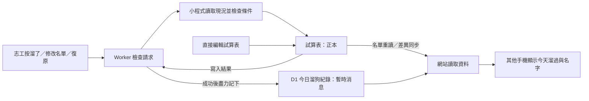
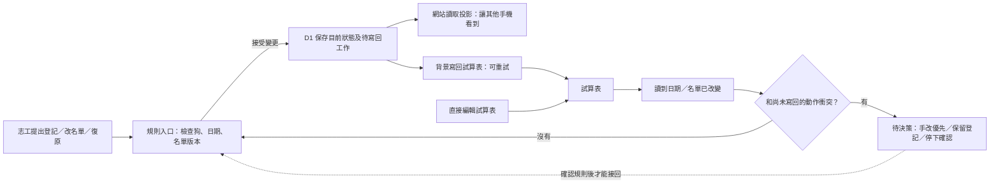

# #441：先決定溜狗紀錄的規則，再決定由哪裡保存

日期：2026-10-21（台灣時間）。Agent：CODEX。範圍：DDD 研究與候選模型，沒有正式架構決策、程式修改或部署。

> 更正（同日重新取得 #441 後）：下文把「D1 為正本」及「手動刪名／清空尊重試算表」寫成尚待選擇，與 [#441 已確認決定](https://github.com/jiatsenK/bq-shelter-dogs/issues/441) 不符。兩者已由 K 確認；正式服務尚未切換，不等於決策未定。下文的權限選項與最小下一步不得直接作為重新詢問 K 的依據。尚待處理的是如何落實既有規則及實測界線。K 本次另說明：網站取消未反映到試算表，才人工補改。昨天原始對話另確認黑寶／MINI 的名單與手機顯示不同步；不能單憑該段推斷取消失敗的技術原因。

**研究判斷：目前最需要釐清的是「網站已接受登記、試算表卻被手動改掉時，以哪個動作為準」。換成 D1 先寫，不能自行回答這個問題。** 現行決策仍是試算表正本；下列候選必須另經確認。[L1][L2]

## 來源與限制

- 已讀名詞表、ADR 0006／0007／0008／0016、實際寫入程式與本票量測報告。[L1]–[L7]
- 此 worktree 沒有 ADR 0017；本報告不補寫它。GitHub Issue 即時讀取受網路限制失敗，票的進度只引用本機紀錄，不假裝已重新取得遠端內容。[L7]
- DDD 一手來源採 Evans 的參考手冊、Fowler 的概念說明，以及 Microsoft 的實作指引。[D1]–[D4]

## DDD 在這題能幫什麼

DDD 先用業務語言建立一致模型；bounded context 是模型與語言適用的邊界，不是看到兩個資料庫就必須切兩個領域。因此本案暫以同一個「溜狗紀錄」討論範圍研究，這是候選分析，還不是正式 context map。[D1：Bounded Context／Ubiquitous Language][D2]

Aggregate 是一起維持規則的領域單位。候選可以是「某隻狗某日的溜狗紀錄」，包含日期、名單與版本；不是整天所有狗的清單，也不是 D1 表名。是否需要跨日一致性，要由「上次溜」與復原的案例再確認。[D1：Aggregates][D3][L4]

領域規則和資料儲存是不同責任；Microsoft 的分層說明也將儲存細節放在基礎設施。本文只借用這個區分，**不建議因此拆微服務，也不要求事件溯源**；候選事件不代表必須永久存每個事件來重建狀態。[D1：Domain Events／Layered Architecture][D4]

## 現行模型：先寫試算表，成功後發布暫時消息

圖中實線表示現有流程；D1 的位置不代表它有權推翻試算表。[L1][L2][L5][L6]

- 小程式以 script lock 序列化經過同一支小程式的請求，今天已有名字就追加未出現的名字；這不能當成鎖住所有人工試算表編輯的證據。[L6：handleRequest、planSheetWrites]
- 編輯與復原都比較當下名單是否符合預期，別人改過便回 `changed`；Worker 隨後把取得的現況轉成今日消息。[L5：todayRows][L6：planSheetWrites]
- 今日消息寫 D1 失敗不使原本登記失敗；試算表已寫成功。這是目前成功承諾的界線。[L2][L5：handleWalk]

## 候選領域模型：讓規則有明確入口

以下名稱全是**研究候選，尚未批准加入 GLOSSARY**。「今日溜狗紀錄」保留既有的暫時 D1 消息定義。[L1]

| 分類 | 候選內容 | 依據／尚待決定 |
|---|---|---|
| 領域單位 | 某隻狗某日的溜狗紀錄 | 同狗、日期、名單需要一起判斷；候選 aggregate，不等同一張表。[D3][L6] |
| 命令：要求做事 | 登記溜了、修改名單、復原今天的紀錄 | 現有 walk／edit／undo；命令可能被拒絕，不能收到請求就稱已完成。[L5][L6] |
| 事件：已發生的事 | 已登記、名單已修改、今天的紀錄已復原 | 候選；僅成功接受變更後才成立。[D1：Domain Events] |
| 查詢投影 | 今天溜過與名字、上次溜、我溜過 | 供不同畫面閱讀的結果；更新延遲與來源規則仍要定義。[L1][L2][L4] |
| 技術工作狀態 | 待寫回、已寫回、重試中、衝突待處理 | 候選同步狀態，不是「有沒有溜」的領域事實。[D4][L7] |

候選規則入口可先是一個模組，不需要新服務；儲存 adapter 負責 D1／試算表的轉換。這是本研究的實作方向建議，尚未確認。[D4]

## 候選流程：網站先接受，再背景寫試算表

**這張圖描述 #441 的候選，不是現況。**「D1 先保存」只回答速度與持久化位置；「誰有最後決定權」仍在右側未定。[L2][L7]

候選必要條件：網站狀態與待寫回工作一起可靠保存；背景失敗不能遺失已接受的動作，重試不能重複追加，也不能因舊快照而覆蓋較新的名單。這些是候選流程的可靠性要求，不是目前原型已完整通過的保證。[L7]

## 必須保留或另作決策的規則

| 案例 | 已有規則／缺口 | 候選處理，待確認 |
|---|---|---|
| 甲乙同時登記同一隻狗 | 現有同支小程式序列化，當天名字追加且去重。[L6] | 同狗同日依版本接受兩筆，保留兩名；相同請求重送不多算。 |
| 手動刪掉甲的名字，同時網站新增乙 | 現行試算表正本；原型沒有測 pending 與人工刪名衝突。[L2][L7] | 不將整串名單無條件聯集，否則甲會復活；也不盲用最後讀到的快照，否則乙可能消失。先定衝突權限。 |
| 看見只有甲，準備復原，但乙剛加入 | ADR 0016 保留「名單被別人改過就停止」；不能取消乙。[L4][L6] | 帶預期版本執行，版本不同則拒絕並重讀，不背景強行重放舊復原。 |
| 換手機復原只有一個名字的今天紀錄 | 選好身分的任何志工皆可，不限本人；伺服器找前一筆並留編輯紀錄。[L4] | 保留權限與追查；不能重新加上「只限自己／原裝置」。 |
| 人工把日期從今天改成昨天／空白 | 正本可改；目前投影測試只有名字，未驗日期。[L2][L7] | 必須連同日期、今日狀態、上次溜與未寫回動作一起判斷，不能只同步名字。 |
| 在午夜前接受、午夜後才重試 | 只認台灣今天、復原只限今天。[L2][L4] | 分開原動作日期與執行重試時間；禁止重試把昨天的登記改成今天。 |

其中「同一筆請求」的識別與版本是候選技術機制；何時算登記完成、誰能推翻它才是產品規則。單靠資料庫時間戳記或最後寫入者優先，無法證明人當初想「刪除」還是看見較舊資料；自由改格子的結果也不能可靠還原成領域命令。[D4][L7，研究推論]

兩條候選路徑是：所有修改經過同一個規則入口；或保留自由編輯試算表，明訂外部改動的協調與衝突規則。前者會改現場習慣，後者保留習慣但增加歧義處理；目前兩者皆未定案，不能單靠更換資料庫省略選擇。[L1][L2][L7，研究建議]

## 最小下一步與驗證界線

**建議先只決定一件事：網站回覆已登記後、試算表尚未寫回時，人工改同一隻狗的日期或名單，可否取消網站已接受的登記？**

可選「手改覆蓋，但須保留衝突紀錄」、「不自動覆蓋，保留待處理」或其他明確規則；本文建議先以「衝突時停下並保留兩邊證據」做可討論的候選，不能默認為 K 已採用。這決定成功承諾與衝突處理，再選保存方式。[L2][L4][L7，研究建議]

確認後先寫一張案例表，固定上述六個案例的最終日期、名單、回應與待寫回狀態，再用單狗、兩個網站動作及一個人工修改的有界模型驗證重送／重排。先補語意證據，**本輪不再增加效能實測**。[L7，研究建議]

目前證據只支持部分正確性：版本快取、加名、清空及還原通過；尚無完整日期修改、三方衝突或復原驗證。包裝量測最大分組 CPU P99 10.591 ms、200 列全 miss 推估讀取超額，是正式管線的風險，不能稱為正式環境已故障，也不能稱為完整方案已達標。[L7]

免費方案與寫入預算仍是驗收限制，領域模型不會消除它；ADR 0008 的差異寫入與預算檢查也不能因背景處理而略過。[L3][L7]

## 引用

- [D1] Eric Evans，[Domain-Driven Design Reference](https://www.domainlanguage.com/wp-content/uploads/2016/05/DDD_Reference_2015-03.pdf)，2015；印刷頁 2–3、10、13、16。
- [D2] Martin Fowler，[Bounded Context](https://martinfowler.com/bliki/BoundedContext.html)。
- [D3] Martin Fowler，[DDD Aggregate](https://martinfowler.com/bliki/DDD_Aggregate.html)。
- [D4] Microsoft，[Design a DDD-oriented microservice](https://learn.microsoft.com/en-us/dotnet/architecture/microservices/microservice-ddd-cqrs-patterns/ddd-oriented-microservice)，Layers／Domain model layer。引用分層原則，不套用該文微服務拆分建議。
- [L1] [GLOSSARY](../../GLOSSARY.md)：試算表、同步、溜狗紀錄、今日溜狗紀錄、復原。
- [L2] [ADR 0006](../adr/0006-sheet-write-scope.md)、[ADR 0007](../adr/0007-today-walks-live.md)：寫入範圍、正本、讀取與失敗語意。
- [L3] [ADR 0008](../adr/0008-diff-sync-and-write-budget.md)：差異同步、寫入前預算。
- [L4] [ADR 0016](../adr/0016-undo-walk-from-server-history.md)：今日復原、跨裝置、開放身分與名單變動限制。
- [L5] [Worker 入口](../../worker/src/index.js)：handleWalk（約 950–1022 行）；[today.js](../../worker/src/today.js)：todayRows、saveTodayWalks、previousWalk。
- [L6] [試算表寫入程式](../../apps-script/sheet-write.gs)：handleRequest（約 32–60 行）、planSheetWrites（約 140–185 行）。
- [L7] [本票快取與預算報告](2026-10-21-d1-walk-cache-budget.md)、[本票工作紀錄](../agent-log/2026-10-21-441-d1-walk-sync-prototype.md)：量測結果、原型邊界及未完成事項。
