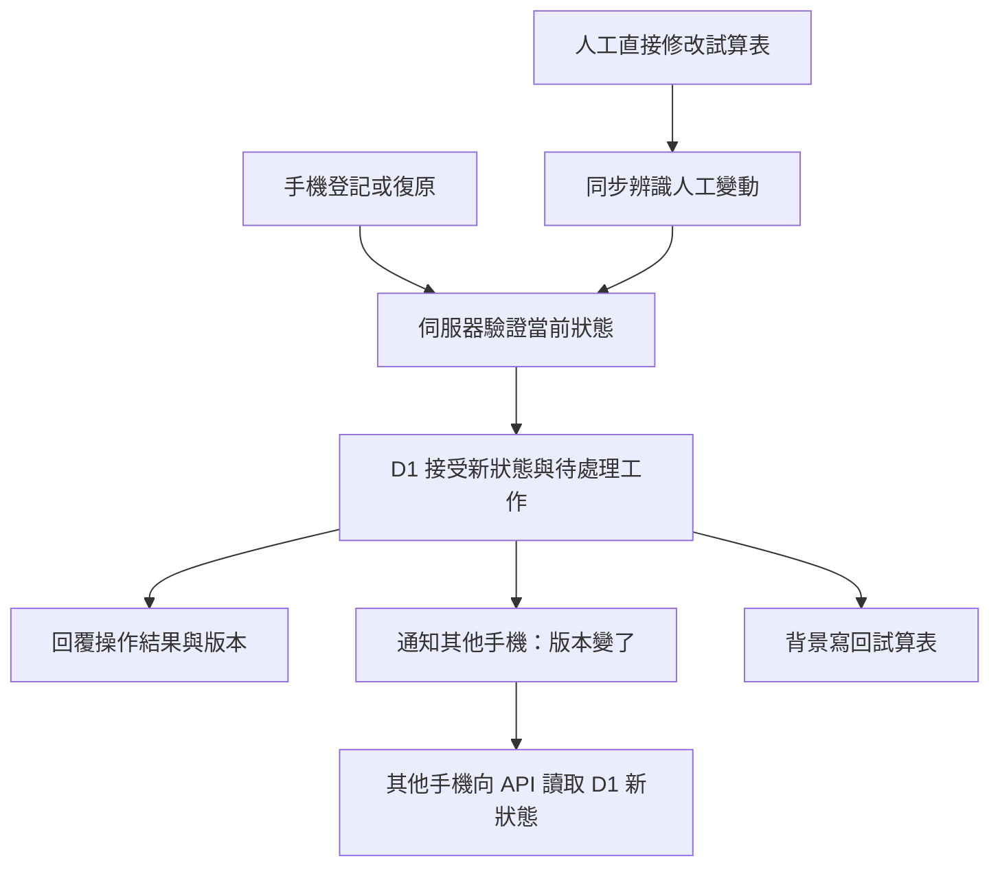

# 售票／庫存怎麼讓大家很快看到同一份狀態

日期：2026-10-21。CODEX。#441 的限量研究；只讀官方資料、整理文件。
這是研究建議，不是架構決定；沒有修改程式、測試、部署或提交。

## 先回答問題

可以借用的做法分兩層：伺服器先決定這次操作是否成立，再通知其他人的畫面重新讀資料。
「不會互相覆蓋」靠第一層；「其他手機很快看到」靠第二層。只加推播無法補好錯誤的寫入規則。
以下以 Seats.io 和 Shopify 庫存 API 為具體例子，不代表所有售票網站或倉儲都用同一架構。

## 例一：售票先接受保留，再確認購買

Seats.io 可讓選中的座位暫時保留；期間其他人不能保留或購買同一座位。
到期仍未確認購買就釋出，因此有人離開購票流程也不會永久占住座位。
這是有期限的業務狀態，而不是前端把座位塗灰就算成立。
來源：[Seats.io：Temporarily hold objects](https://docs.seats.io/docs/api/temporarily-hold-objects/)。

Seats.io 也明說：先查座位是否還保留、之後才送購買，兩次呼叫之間仍可能到期。
應由最後的購買呼叫驗證，並處理失敗；畫面剛才看起來可買，不是成功保證。
來源：[Seats.io：Get the objects for a hold token](https://docs.seats.io/docs/api/get-objects-for-a-hold-token/)。

對本網站的推論：值得借的是「由伺服器接受操作」，不是照搬搶票鎖。
#441 已確認同狗同日兩人登記保留兩名；不需要新增獨占、排隊或登記到期。

## 例二：庫存避免拿舊數字蓋掉新數字

Shopify 的 `inventorySetQuantities` 支援先比對再寫入：呼叫端附上預期的原數量，
伺服器目前的數量符合才接受；不符就回報資料已過時，避免同時操作互相覆蓋。
目前文件用 `changeFromQuantity` 表達這項條件，並建議保留比對。
來源：[Shopify：inventorySetQuantities](https://shopify.dev/docs/api/admin-graphql/latest/mutations/inventorySetQuantities)。

例如兩人都看到 10 件，一人已改成 9 件，另一人再以「原本 10 件」要求改成 8 件，
應先拒絕並重新讀取，而不是不問現況就把數字蓋成 8。
這是依官方條件整理的示例，不是對特定倉儲實作的調查。

對本網站的推論：登記、復原、試算表人工刪名，不能都拿舊名單整包覆蓋。
每次操作需依已確認規則處理當前狀態；重送同一操作也不能多生一份紀錄。
版本只是辨認資料新舊的工具，遇到衝突如何合併仍需由 #441 的規格定義。

## 其他人的畫面如何知道有變動

| 方法 | 如何得知變動 | 對 #441 的意義 |
| --- | --- | --- |
| 定時詢問（polling） | 每隔一段時間查版本，有變才讀資料 | 可以沿用，但兩次查詢之間會等待；一分鐘詢問不能保證立即看到 |
| SSE | 伺服器用持續連線單向通知手機 | 適合「資料變了」這種單向訊息；送出登記仍可走現有 HTTP API |
| WebSocket | 手機與伺服器可互傳訊息 | 也能通知變更，但仍需處理連線、重連與漏訊息 |

SSE 的 `EventSource` 是伺服器到手機的單向連線；文件提供事件 ID、重連等待時間，
並說明斷線後預設會重連。這些機制不會自動替應用程式補回漏掉的業務資料。
來源：[MDN：Using server-sent events](https://developer.mozilla.org/en-US/docs/Web/API/Server-sent_events/Using_server-sent_events)。

Cloudflare 官方提供 Durable Object 的 WebSocket 伺服器及多連線處理範例，
休眠 API 可在連線保持時降低 duration 費用；這讓它成為可評估的通知集中點。
它不代表本案一定免費、一定較快，也不代表已同意新增 Durable Object。
來源：[Cloudflare：WebSocket Hibernation server](https://developers.cloudflare.com/durable-objects/examples/websocket-hibernation-server/)。

## 套回 #441：通知只提醒去讀 D1

以下是候選流程，沿用已確認的 D1 正本、手機只讀 D1，以及試算表同步狀態分開顯示。

此圖描述責任，不指定 D1 SQL、交易邊界或同步頻率；這些仍待正式設計。
人工改試算表必須先被接收進 D1，其他手機才會看見；推播無法略過這段偵測延遲。
試算表若只靠每分鐘同步，這段入口等待仍存在，即使後面有 WebSocket 也一樣。

候選可靠性要求如下，屬工程推論，尚未實作或驗證：

- D1 接受後，操作手機立刻反映結果；待寫回時沿用已接受的「試算表同步中」。
- 通知帶版本即可；手機再向 API 讀 D1，回應版本不得落後於已知版本，舊回應不能蓋掉新畫面。
- 首次連線、重連及回到前景都重新核對版本；訂閱建立與首次讀取之間也要補查，避免剛好漏通知。
- D1 寫入成功、發通知前可能中斷。若要保證可重試，需把待通知工作與狀態一起可靠保存，
  由背景工作重送；這就是 outbox 的用途。不能只呼叫一次發送就宣稱不會漏。
- 可合併連續版本通知，並保留低頻版本核對補漏；通知重複、順序顛倒也不應改壞狀態。
- 試算表寫回工作同樣需驗版本，避免舊登記晚到又把已復原的名字加回。

## 建議先後順序與停止條件

第一步先完成一條可信的寫入路徑：D1 接受、其他手機讀相同狀態、試算表背景寫回，
並明列人工修改如何進 D1。這解決資料一致性，尚不保證其他手機立即更新。

第二步才比較現有詢問方式與小型變更通知；SSE／WebSocket 是候選，不先決定新增服務。
比較時分開量「操作接受→其他手機顯示」及「人工改表→D1→其他手機顯示」，
同時記錄請求量、D1 讀寫列數、CPU、連線與重連成本，沿用既有帳號預算。
本次不追加量測，不宣稱低於免費額度；須先限定樣本與停止條件，再另行確認驗證範圍。

產品行為依據：[2026-10-21 #441 方案收斂](2026-10-21-441-design-convergence.md)。
舊 GLOSSARY 的「今日溜狗紀錄」仍描述 ADR 0007；本研究不修改名詞表或把草稿升為 ADR。
