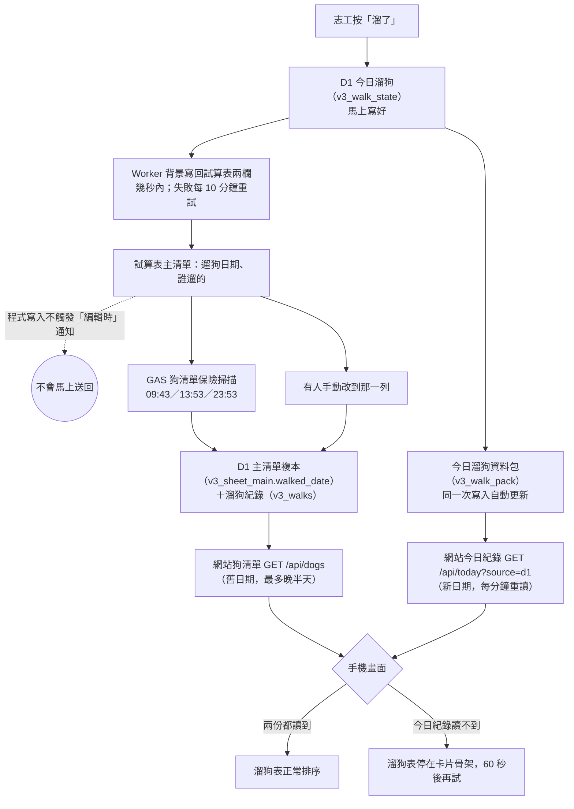

# 今日溜狗紀錄讀不到時，溜狗表為什麼停在載入畫面（2026-10-26）

問題：K 問「試算表都有日期，網站為什麼會不知道？」「以前沒有這樣過吧？」。以 main `3e7b7ba`（#609 之後）的程式碼為準。

> 後續：K 2026-10-26 選最後一節的做法（狗清單帶今日溜狗日期與紀錄），已在分支 `claude/dogs-today-date` 實作；下面描述的是實作前的行為。

## 白話結論

1. 志工按「溜了」，日期**馬上**寫進 D1 的「今日溜狗」那份，幾秒內也寫到試算表；但網站狗清單用的那份日期（D1 主清單複本）**不會跟著改**，要等試算表的保險掃描（每天 09:43、13:53、23:53）或有人手動改到那一列，才會更新。
2. 所以網站打開時要讀兩份：狗清單（舊日期）＋今日溜狗紀錄（新日期）。只讀到狗清單時，剛被溜過的狗會顯示成「幾天沒溜」。
3. 為了不顯示錯的日期，從 10/24（#533）起改成「今日紀錄讀到才排溜狗表」；讀不到就一直顯示灰色卡片骨架，每分鐘自動重試一次。10/24 以前讀不到也會先顯示，所以 K 說「以前沒有這樣過」是對的。
4. 兩份資料來自同一台伺服器、同一個資料庫，正常情況下很少「狗清單讀到、今日紀錄讀不到」；比較可能是手機訊號差、剛好斷線，通常下一分鐘就好。repo 裡沒有任何發生過的回報或紀錄。
5. 選 (a)「先顯示、標示還沒確認」：不會整頁空白，但剛被溜的狗可能被排到前面、被再帶一次（資料不會壞，名字會合併）。選 (b) 維持現狀：不會顯示錯的日期，但溜狗表那一頁要等到讀到才看得到狗。

## 流程圖

## 1. 按「溜了」之後，日期依序寫到哪裡

| 順序 | 寫到哪 | 什麼時候 | 來源 |
|---|---|---|---|
| ① | D1 `v3_walk_state`（每隻狗目前的溜狗日期與名單） | 按下去那一次就寫好，跟待寫回工作（`v3_walk_outbox`）同一次寫入 | `worker/src/walk-accept.js:150-158`；`docs/ARCHITECTURE_NOW.md:18` |
| ② | D1 `v3_walk_pack`（網站讀今日紀錄用的一整包） | 跟 ① 同時，由資料庫自動規則（觸發器）更新 | `db/compact-schema.sql:83-91` |
| ③ | 試算表「遛狗日期」「誰遛的」兩欄 | Worker 回應志工後在背景送出（`ctx.waitUntil`），通常幾秒；Google 沒回或失敗時，每 10 分鐘（`5-59/10`）重試 | `worker/src/index.js:633`、`worker/src/index.js:24`、`apps-script/sheet-write.gs:137-158` |
| ④ | D1 `v3_sheet_main.walked_date`（網站狗清單的日期）與 `v3_walks`（溜狗歷史，我溜過用） | **不是按溜了時寫的**。要等試算表把整列送回 Worker：每天 09:43、13:53、23:53 的狗清單保險掃描，或有人手動改到那一列 | `worker/src/dog-list.js:86-97`（只有這裡更新日期並寫 `v3_walks`）；`apps-script/sheet-write.gs:349, 526-541`；`worker/src/dog-list.js:246-250` |

查證重點：

- **`walk-accept.js` 沒有更新 `v3_sheet_main.walked_date`。** 整個檔案對 `v3_sheet_main` 只有讀（`walk-accept.js:63-73`，用來找狗、當第一次登記的起點），沒有任何 UPDATE。它也沒有寫 `v3_walks`；全 Worker 寫 `v3_walks` 的只有 `dog-list.js:57-58`。
- **`v3_sheet_main` 只由 `dog-list.js` 更新。** 全 `worker/src` 搜尋，INSERT／UPDATE／DELETE `v3_sheet_main` 都在 `dog-list.js`（62、80、92、115 行），資料來自 GAS 送來的 `POST /api/walk-writeback/dog-list`（`docs/ARCHITECTURE_NOW.md:20`）。
- **Worker 寫回試算表後，試算表不會馬上把新日期送回 D1。** GAS 的「編輯時」觸發只對人手動編輯有反應，程式寫入不觸發：`apps-script/sheet-write.gs:333` 註解「網站寫回（doPost）是程式寫入，不會觸發」；Google 官方說明見 `docs/research/2026-10-20-sheet-db-sync-prior-art.md:44`。
- **補上的是 GAS 的 `dogListScan`，不是 `walkScan`（更正你的初步說法）。** 兩個都在 09:43／13:53／23:53 跑，但分工不同：
  - `dogListScan`（GAS 時間觸發，`sheet-write.gs:349, 526`）送主清單每一列的指紋，指紋包含日期和名單（`sheet-write.gs:576-582`）。Worker 寫回後那一列指紋變了，Worker 就會要那一列（`dog-list.js:250`），然後更新 `v3_sheet_main.walked_date` 和 `v3_walks`。**這才是把新日期帶回狗清單的路。**
  - `walkScan`（Worker 排程叫 GAS，`index.js:25, 842`；`walk-reconcile.js:51-56`）只拿試算表跟 `v3_walk_state` 比，抓「有人手動改了試算表」的情況，改的是 `v3_walk_state`，不碰 `v3_sheet_main`（`walk-reconcile.js:27-34`）。
  - Google 只保證時間觸發在那個小時內、約略那幾分（`sheet-write.gs:347` 註解）。
- 每 10 分鐘的 `flushDogList` 只補送「人手動編輯後沒送成功」的列（`sheet-write.gs:362-366, 488-512`），不會掃到程式寫入的日期。

**結論：** 按溜了到狗清單日期更新，最快要等到下一次狗清單保險掃描。早上 10 點溜的，約 13:53 才更新；下午 2 點溜的，約 23:53 才更新。

## 2. 網站狗清單給的 `walkedDate` 是哪一份

- `GET /api/dogs` → `getDogs`（`worker/src/index.js:167-185`）→ `readDogsPacked`（`worker/src/packs.js:373-378`）→ `readDogsPayload`（`worker/src/compact.js:20-29`）。
- `walkedDate` 直接取 `v3_sheet_main.walked_date`（`compact.js:13` 欄位對照、`compact.js:23` 查詢）。**沒有合併 `v3_walk_state`**：`compact.js`、`packs.js` 都沒有讀 `v3_walk_state`。
- 對照：志工名字建議 `/walkers` 有合併（`index.js:509-533`：「有今日溜狗狀態（v3_walk_state）用它，沒有用主清單的遛狗日期」），狗清單沒有。

**舉例：** 「栗子」狗清單上次溜是 10/24。10/26 早上 10:00 小明在網站按溜了：

| 時間 | D1 今日溜狗 | 試算表 | 網站狗清單（`/api/dogs`） |
|---|---|---|---|
| 10:00 | 10/26 小明 | 幾秒內變 10/26 小明 | **10/24**（還沒動） |
| 12:00 另一位志工打開網站 | 10/26 小明 | 10/26 小明 | **10/24**，看起來「2 天沒溜」 |
| 約 13:53 掃描後 | 10/26 小明 | 10/26 小明 | 10/26 |

所以中午那位志工的手機一定要讀到今日紀錄（`/api/today?source=d1`）才知道栗子今天溜過。今日紀錄那一包也包含之前從網站登記過、狗清單還沒追上的狗（`walk-accept.js:28-34` 讀整包；`compact-schema.sql:83-87` 每隻狗一格）。

## 3. 讀不到時畫面實際長怎樣、多久重試

- 打開網頁時今日紀錄狀態先設成「讀取中」（`public/js/app.js:772`）。
- 讀今日紀錄：`walk-flow.js:58-67` 的 `loadToday`。8 秒沒回就中止（`walk-flow.js:107-116`）；連不上、伺服器回錯、回應不是 D1 格式，都回「沒讀到」，不顯示錯誤訊息（`walk-flow.js:66` 註解「抓不到就維持現況，下次再試」）。
- `app.js:774-778` 的 `loadTodayWalks`：**只有讀到**才把狀態改成「好了」並重畫（`app.js:777`）。沒讀到就一直是「讀取中」。
- 畫面判斷：
  - **溜狗表**：狀態是「讀取中」就只畫灰色卡片骨架（`app.js:1983-1987`、骨架 `app.js:1795`）。分類列的隻數照常顯示。
  - **我溜過**：顯示「讀取溜狗紀錄中…」（`app.js:340`），數字顯示「…」（`app.js:220`）。
  - **找狗、狗群**：不等今日紀錄（`app.js:1962-1966, 1994-1997` 沒有這個判斷）。找狗頁的「最久沒溜的狗」用的日期在讀到前會退回狗清單的舊日期（`find.js:341-344` → `app.js:412` → `walk-registration.js:33-37`、`app.js:839-842`）。
- 重試：每 60 秒一次（`app.js:767, 2305`），畫面在背景時不抓；切回網頁且距上次超過 30 秒會馬上抓（`app.js:768, 779-783, 2304`）。按頁首「更新」也會重抓（`app.js:2104-2108, 2122`）。沒有「重試」按鈕，也沒有提示文字。
- 小缺口（只影響測試環境）：網址不是 https（例如本機開檔）時 `loadToday` 一開始就回「沒讀到」（`walk-flow.js:61`、`app.js:27, 831`），溜狗表會永遠停在骨架；#424 時這種情況會直接顯示。正式網站不會遇到。
- **手機沒有離線快取狗清單。** 沒有 service worker（`public/` 搜尋不到 `serviceWorker`、`caches.open`）。`public/index.html:18` 的 `__dogsEarly` 只是網頁一開就提早發出 `/api/dogs` 請求、讓 `api.js:35-39` 接手，省等待時間，不是存在手機上的備份。沒網路時狗清單也讀不到，會顯示「狗的資料讀不到…重新讀取」（`app.js:1968-1976`）。

## 4. 歷史：什麼時候從「讀不到也顯示」變成「讀到才顯示」

用 `git log -S` 核對，你的初步說法**全部正確**，補充正式網站實際生效的時間：

| 日期 | 改了什麼 | 正式網站的行為 | 來源 |
|---|---|---|---|
| 10/19 以前 | 沒有「等今日紀錄」這件事 | 狗清單到了就排 | `git log -S todayState` 最早只到 `c5a109d` |
| 10/19 | #424（`c5a109d`）新增「讀取中」狀態，避免啟動時狗卡跳來跳去；但寫在 `finally`，成功失敗都會放行 | 讀不到也會顯示 | `c5a109d:public/js/app.js:1300-1310` |
| 10/22 | #456／PR #461（`2701767`）放行條件改成 `(!SITE.d1WalkAccept \|\| received)`：開關打開時要讀到才放行 | 開關還關著，**行為不變** | `2701767:public/js/app.js:1323-1333`；`docs/agent-log/2026-10-21-456-d1-walk-accept.md:5` |
| 10/24 14:10 | #533（`06b7838`）打開 `d1WalkAccept` | **從這時起讀不到就停在骨架** | `git log -S "d1WalkAccept: true"` |
| 10/26 | #607（`95e533f`）刪掉開關，條件只剩 `received` | 跟 10/24 起一樣 | `95e533f`；`docs/agent-log/2026-10-26-front-r1-legacy-walk.md:11` |

為什麼 #456 要這樣設計：設計稿寫明「已接管的狀態不再接受舊 today、walkers、狗清單日期或本機已溜紀錄覆蓋」（`docs/design/history/456-d1-walk-accept.md:11`）。也就是不想讓第 2 節那個舊日期顯示出來。commit 和 PR 沒有另外寫「讀不到時怎麼辦」，沒有找到 K 對這點做過決定的紀錄。

這個行為是 #607 改測試時才發現並記下來：agent-log 寫「D1 模式一開頁讀今日紀錄失敗時，溜狗表停在載入畫面……留給 K」（`docs/agent-log/2026-10-26-front-r1-legacy-walk.md:11`）；原本測試「今日紀錄失敗仍可看狗」也是那次改掉的。

## 5. 兩個選項的實際後果

### 現實上多常發生

- `/api/dogs` 和 `/api/today?source=d1` 是同一台 Worker、同一個 D1，開頁時幾乎同時發出（`app.js:2049, 2083`）。今日紀錄只讀 D1 一列（`walk-accept.js:30`），比狗清單還輕。
- 會「狗清單讀到、今日紀錄讀不到」的情況大概只有：剛好在兩個請求之間斷網或訊號太差、8 秒逾時、D1 短暫出錯（伺服器回 503，`index.js:793`）。D1 整個掛掉的話狗清單通常也讀不到，兩個選項都一樣看到「狗的資料讀不到」。
- repo 裡沒有使用次數、錯誤次數的紀錄，也沒有志工回報過；10/24 打開到現在才兩天。**頻率無法用資料證明，只能推測是少見且通常一分鐘內就好。**

### (a) 讀不到時先用狗清單日期顯示，並標示「今天的登記還沒確認」

- 好處：溜狗表不會空白；跟 10/24 以前一樣。
- 壞處：從上一次狗清單掃描以後在網站登記過的狗，會顯示舊日期（第 2 節例子：栗子顯示「2 天」），還可能被排到前面的「該溜了」位置。志工若沒注意標示，可能**再帶同一隻狗出去**，而真正很久沒溜的狗被跳過。
- 資料不會壞：志工再按溜了時，伺服器用 D1 的最新狀態合併名字（`walk-accept.js:133-138`），結果是「10/26 小明、小華」，不會蓋掉小明，也不會多一筆重複紀錄。讀到今日紀錄後畫面會自動改正。
- 影響範圍：只有「最近一次狗清單掃描之後」從網站登記的狗；早上第一個打開網站、09:43 掃描剛跑過時，幾乎沒有落差。

### (b) 維持現狀：讀到才顯示

- 好處：溜狗表上不會出現錯的日期，不會因為這樣重複帶狗。
- 壞處：讀不到的那段時間溜狗表**整頁看不到狗**，只有灰色骨架，沒有說明也沒有重試按鈕，最多等 60 秒自動重試，或自己按「更新」。這段時間可以先用「找狗」，但找狗頁的「最久沒溜的狗」用的也是舊日期（第 3 節），所以 (b) 也不是完全不會看到舊日期。
- 若連續讀不到（例如訊號一直很差），會一直停在骨架。

### 兩個選項以外的根本解法（供參考，未評估成本）

讓 `/api/dogs` 的日期直接合併 `v3_walk_state`（比照 `/walkers` 的 `index.js:509-533`），狗清單本身就是新日期，讀不到今日紀錄時也不會錯。這要改 Worker 和狗清單資料包的更新時機（今日溜狗一改就要讓狗清單包失效），屬於資料讀取來源變更，要照 `docs/agents/data-changes.md` 另開票評估。

## 補充：#613 合併後（2026-10-26 14:10）

- PR #613（merge `5179785`）讓網站按溜了、改溜狗人、復原時，在同一批寫入裡一起改溜狗歷史 `v3_walks`（圖鑑、我溜過讀這份）。
- 它**沒有**更新 `v3_sheet_main.walked_date`：#613 的 diff 沒有任何寫 `v3_sheet_main` 的語句；main 上 `worker/src/walk-accept.js` 對 `v3_sheet_main` 仍只有 SELECT（`:75`、`:83`）。
- `/api/dogs` 仍讀 `m.walked_date`（`worker/src/compact.js:23`，#613 未改此檔）。所以上面的結論不變：狗清單日期要等 `dogListScan` 每天三次或人工改那一列才更新，讀不到今日溜狗紀錄時網站仍只有舊日期。

## 評估：讓狗清單直接帶今天的溜狗日期（K 2026-10-26 交辦，照 `docs/agents/data-changes.md`）

### 做法
`GET /api/dogs`（`worker/src/index.js:168` `getDogs`）回應前，多讀一列 `v3_walk_pack`（`SELECT version,payload FROM v3_walk_pack WHERE id=1`，跟 `/today` 用的同一列，`worker/src/walk-accept.js:31`）：
1. 主清單上每隻狗，`v3_walk_pack` 有那隻（key＝編號或 `名:狗名`，`walk-accept.js:11`）就用它的 `walkedDate` 蓋掉 `v3_sheet_main.walked_date`。D1 是今日溜狗正本（ADR 0018），復原、人工改表比對後的結果也都在這列，所以直接以它為準。
2. 回應另外帶 `today: { version, date, source: 'd1', walks }`（只放主清單上的狗），形狀跟 `/today?source=d1` 一樣。前端 `applyDogsData` 收到就交給 `walkRegistration.receiveToday`，`todayState` 直接變 ready。
   - 只改日期不夠：前端 `d1Base`（`public/js/app.js:840-843`）把 `dog.walkedDate` 跟 `dog.walkers`（試算表的代號）配在一起判斷「是不是我溜的」；只蓋日期，代號還是舊的，會配錯。帶上 `today` 讓前端走已接受狀態那條路（`walk-registration.js:27-32`），不用 `d1Base`。
3. 效果：狗清單讀到＝今天的紀錄也讀到，開頁不會再卡在「狗清單有、今天紀錄沒有」。`/today` 每分鐘重讀照舊，只負責之後的更新。

### 成本（data-changes.md 逐項）
| 項目 | 要不要 | 說明 |
|---|---|---|
| D1 寫入 | 不用 | 只在讀的時候合併，不寫任何表；ADR 0008 寫入預算不受影響 |
| D1 讀取 | 每次開頁 +1 列 | `v3_walk_pack` 只有 1 列（`db/compact-schema.sql:68-73`）；`/today` 本來每分鐘就讀這列 |
| migration／schema | 不用 | 沒有新表、欄、觸發器 |
| ADR 0009 資料包觸發器 | 不用 | 合併在 `smallPack` 快取之外做，不放進 `main` 資料包，`v3_pack_versions.small` 不跳；要複製物件，不可改到 `mem.small` |
| 回應大小 | 多一份今日紀錄 | 跟 `/today` 一樣的內容、只留主清單上的狗；`/today` 開頁本來就會抓一次 |
| ADR | 補修訂行 | ADR 0018 加一行「狗清單回應以 D1 今日溜狗為準」；`docs/ARCHITECTURE_NOW.md` 狗清單一列同步改 |
| 其他讀狗清單的地方 | 不受影響 | 管理網站走自己的路由（`worker/src/admin/index.js`）；cards／groups／edits 頁不讀 `walkedDate`；Worker 內部 `readDogsPacked` 只有 `getDogs` 用 |

### 畫面會變的地方（都是變正確）
- 找狗頁「最久沒溜」、詳細資訊「上次溜」、電腦版天數：今天溜過的狗馬上顯示今天，不用等每天三次的掃描。
- 重新整理後按復原：狗清單已是今天，手機沒有登記前的日期，照 ADR 0018 第 22 行顯示「取消中」等 D1 回應。這個情況以前掃描後也會出現，只是之後會更常見。

### 工作量與測試
- Worker：`getDogs` 合併＋帶 `today`（約 20 行）；`worker/test/d1-read.test.mjs` 加：有今日狀態時日期以 D1 為準、復原回較早日期、主清單外的狗不放、`mem.small` 沒被改。
- 前端：`applyDogsData` 收 `today`；`tests/index/startup.js` 或 startup-stability 加：`/today` 失敗但 `/dogs` 帶了 today 時，溜狗表直接出現狗卡。
- 一張 PR，可單獨還原（雙向門）。
