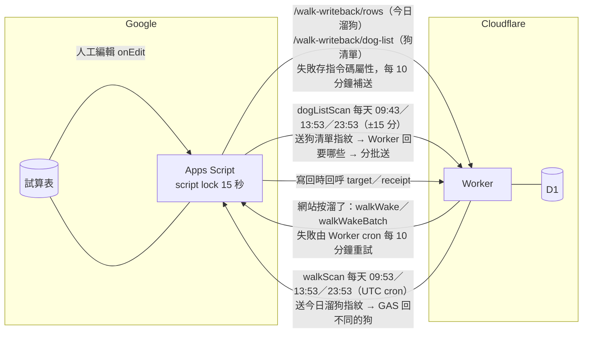

# Worker 與 GAS 兩個方向同步、兩個保險掃描：這樣合理嗎

- 日期：2026-10-26（台灣時間）。Agent：Claude Code 研究代理。
- 問題（K）：試算表 → 網站靠 GAS 編輯觸發＋GAS 的狗清單保險掃描；網站 → 試算表靠 Worker 呼叫 GAS 寫回＋Worker 的今日溜狗保險掃描。兩個保險掃描一個在 GAS、一個在 Worker，又排在同一分鐘、搶同一把鎖。這樣合理嗎？
- 範圍：只讀 repo（基準 origin/main `49106ff`）和官方文件。沒有改程式、沒有查正式 D1、沒有看 GAS 執行紀錄、沒有部署。
- 標記：每個主張附來源；從程式推得、沒實測的寫【推論】。

## 1. 給 K 的白話結論

- **大致合理，不用大改。** 兩個掃描分在兩邊有原因：狗清單的比對資料在試算表那邊算、要分很多批送，放在 Worker 一次做完會超過免費方案的 CPU 和連線次數；今日溜狗的指紋本來就在 D1。
- **同一分鐘撞在一起不會弄壞資料**，最差是其中一次保險掃描失敗，等下一次（最久約 10 小時）再補。正常情況只是排隊幾秒。
- 會失敗的情況：剛好有人在那一分鐘整群登記（寫回最多佔鎖幾十秒）。GAS 等鎖 15 秒，Worker 只等 20 秒，等不到就算這次失敗。
- 建議最小改動（擇一，都可不做）：**Worker 保險掃描改到別的分鐘**（只改兩個檔、部署即生效），或把 Worker 叫 `walkScan` 的逾時拉長到 45 秒。
- 不建議合併成單邊發起，也不建議換成 onChange、Drive 推播或 Worker 直接用 Sheets API 讀表。

## 2. 現況圖

| 工作 | 發起 | 時間 | 持 script lock 的範圍 | 來源 |
|---|---|---|---|---|
| 網站登記寫回（`walkWake`／`walkWakeBatch`） | Worker → GAS `doPost` | 按溜了當下（`waitUntil`）＋每 10 分鐘重試 | 整個處理過程，包含每隻狗 2～3 次回呼 Worker | `worker/src/index.js:637`、`worker/src/walk-retry.js:15-36`、`apps-script/sheet-write.gs:40-47,137-158` |
| 今日溜狗保險掃描（`walkScan`） | Worker cron → GAS | `53 1,5,15 * * *`＝台灣 09:53、13:53、23:53 | 讀主清單四欄＋算每隻 SHA-256 | `wrangler.jsonc:39-41`、`worker/src/index.js:26-27,843-853`、`worker/src/walk-reconcile.js:53-62`、`apps-script/sheet-write.gs:100-129` |
| 人工改表送 Worker（`flushWalkEdits`） | GAS onEdit＋每 10 分鐘 | 編輯當下 | 讀表＋HTTP 送 Worker（持鎖等網路） | `apps-script/sheet-write.gs:352-376,390-412` |
| 狗清單送 Worker（`flushDogList`） | GAS onEdit＋每 10 分鐘 | 編輯當下 | 每批讀三個分頁＋HTTP（持鎖等網路），最多 10 批 | `apps-script/sheet-write.gs:488-513` |
| 狗清單保險掃描（`dogListScan`） | GAS 時間觸發 | `atHour(9/13/23).nearMinute(43/53/53)` | 只有讀三個分頁；送 HTTP 前放鎖 | `apps-script/sheet-write.gs:347-349,526-542` |

註：ADR 0018 第 5 點字面寫「GAS 送今日溜狗欄與狗清單的指紋」，實作是今日溜狗由 Worker 發起；agent-log 已記這個差異，「效果相同」（`docs/agent-log/2026-10-23-500-walk-edit-sync.md:8`）。`docs/ARCHITECTURE_NOW.md:34-38` 的排程表與程式一致。

## 3. 逐題分析

### 3.1 兩個保險掃描分屬兩邊，合理嗎？能不能合併？

兩個掃描其實是同一個模式：「一邊送指紋，另一邊回哪些不同」。差別在指紋存在哪邊：

- 今日溜狗：D1 記著每隻狗上次看到的表上值（`base_date`／`base_walker`），Worker 算指紋送去，GAS 讀表比完只回不同的狗（`worker/src/walk-reconcile.js:45-62`、`apps-script/sheet-write.gs:121-125,552-559`）。Worker 在遠端讀表前先取 D1 狀態，提交時再核對版本，避免讀表期間的新登記被撤銷（`worker/src/walk-reconcile.js:6-8,28`）。這個保護要在 Worker 端做。
- 狗清單：指紋要從三個分頁（主清單、已出所、常遛狗群）組出「單位」再算（`apps-script/sheet-write.gs:563-620`），最多 600 個單位分 60 批送（`apps-script/sheet-write.gs:475,537-541`）。每批是一個獨立 HTTP 請求，各自有 Worker 的 CPU 額度。

**方案 A：都由 GAS 時間觸發器發起**（GAS 先向 Worker 要今日溜狗指紋，再把不同的狗送 `/rows`）

- 好處：只有一個排程來源；兩個掃描在同一次執行裡依序跑，不會互搶鎖；Worker 不必在掃描時呼叫 GAS。
- 壞處：
  - GAS 觸發器會漏：失敗不重跑，觸發器總執行時間用完就停（ADR 0018 第 5 點，`docs/adr/0018-today-walks-d1-event-sync.md:13`；配額見 3.3）。保險掃描本來就是補「觸發器漏掉」的，再把它放在同一個會漏的機制上，等於兩層保險共用一個弱點【推論】。
  - 現在 Worker 掃描每次跑完或出錯都記在 D1 `cron_scan`，管理網站看得到（`docs/ARCHITECTURE_NOW.md:41`）；GAS 失敗只寄「Summary of failures」郵件給 K（[installable triggers](https://developers.google.com/apps-script/guides/triggers/installable)）。
  - `/rows` 走的是 `reconcileWalk`，跟掃描用的 `reconcileWalkSnapshot`（先取版本再比）不同路徑，要重新驗證掃描期間有新登記時不會撤銷【推論】。
  - K 要重新部署 GAS、重跑 `installWalkEditTriggers`。

**方案 B：都由 Worker cron 發起**（Worker 向 GAS 要狗清單指紋，再要那幾個單位的資料）

- 好處：一個排程來源，失敗記在管理網站。
- 壞處：
  - 免費方案每次 cron 只有 10 ms CPU、50 個子請求（[Workers limits](https://developers.cloudflare.com/workers/platform/limits/)）。狗清單第一次或大量不同時要寫幾百個單位，原本分 60 次 HTTP、各自 10 ms，合在一次 cron 很可能超過 CPU 與子請求上限【推論】。#460 就是因為 cron 一次做太多超過 10 ms 才改成現在的設計（`docs/adr/0018-today-walks-d1-event-sync.md:5`）。
  - 要在 GAS 加新動作、Worker 加分批與續傳。

**判斷**：兩邊各自發起是合理的分工——**誰持有指紋、誰的資源比較多，就由誰發起**。合併的好處只有「不搶鎖」，用錯開時間就能拿到（見第 4 節）。

### 3.2 同時段搶 script lock：排隊還是失敗？

**實際秒數（程式）**

| 地方 | 等鎖 | 鎖內做什麼 | 等不到時 |
|---|---|---|---|
| `doPost`（`walkScan`、`walkWake`、`walkWakeBatch`） | `waitLock(15000)`（`apps-script/sheet-write.gs:41`） | 掃描：讀四欄、每隻狗算一次 SHA-256。寫回：每隻狗回呼 Worker `target`、`receipt`（可能加 `observe`），合併派送最多 10 隻（`:130-158`） | 丟錯 → `doPost` 接住回 `{ok:false}`（`:19-23`）。Worker 記成失敗 |
| `flushWalkEdits` | `waitLock(15000)`（`:400`） | 讀主清單四欄＋HTTP 送 Worker | 接住，留著待送，下次補（`:405-407`） |
| `flushDogList` | `waitLock(15000)`（`:498`） | 讀三個分頁＋HTTP，最多 10 輪，每輪重新拿鎖 | 接住，留著待送（`:506-508`） |
| `dogListScan` | `waitLock(15000)`，**在 try 外面**（`:530`） | 只讀三個分頁，HTTP 前就放鎖（`:531`） | 整次執行失敗，GAS 寄失敗通知；等下一次掃描 |
| Worker 呼叫 GAS | — | `AbortSignal.timeout`：一般 20 秒、`walkWakeBatch` 90 秒（`worker/src/sheet-write.js:7-9,33`） | 記為「連不上試算表」；GAS 那邊可能其實還在跑 |

**官方說法**

- `waitLock`：「Attempts to acquire the lock, timing out with an exception after the provided number of milliseconds」；`tryLock` 則回 true／false 不丟錯（[Lock](https://developers.google.com/apps-script/reference/lock/lock)）。
- script lock 不分使用者，同一個專案所有執行共用（[LockService](https://developers.google.com/apps-script/reference/lock/lock-service)）。網頁應用程式（`doPost`）和觸發器都在同一個專案，所以都搶同一把。
- `nearMinute`：「plus or minus 15 minutes」（[ClockTriggerBuilder](https://developers.google.com/apps-script/reference/script/clock-trigger-builder)）；時間觸發器「might be slightly randomized」，選定後「keeps that timing consistent from day to day」（[installable triggers](https://developers.google.com/apps-script/guides/triggers/installable)）。所以 GAS 的 09:43 實際落在約 09:28～09:58，**也可能跟 Worker 的 09:53 撞**；13:53、23:53 兩次本來就同一分鐘。
- Cloudflare：cron 用 UTC；官方沒寫準時程度（[Cron Triggers](https://developers.cloudflare.com/workers/configuration/cron-triggers/)）；子請求「no set time limit」，cron 每次最多 15 分鐘牆鐘時間；`waitUntil` 在回應後最多再延 30 秒（[Workers limits](https://developers.cloudflare.com/workers/platform/limits/)）。所以 20 秒是本 repo 自己設的，不是平台限制。

**情境推演【推論，未實測秒數】**

1. **只有兩個掃描撞在一起（最常見）**：`dogListScan` 持鎖只讀三個分頁，估幾秒；`walkScan` 排在後面等幾秒，再讀四欄。Worker 端總時間＝GAS 網頁應用程式啟動＋轉址＋等鎖＋讀表，應在 20 秒內。**結果：排隊，不失敗。** 反過來 `walkScan` 先拿到鎖，`dogListScan` 等它讀完也一樣。
2. **掃描那分鐘剛好有整群登記**：`walkWakeBatch` 在鎖內逐隻回呼 Worker 2～3 次，10 隻約 20～30 次 UrlFetch，持鎖可能幾十秒（Worker 給它 90 秒逾時正是因為這樣，`worker/src/sheet-write.js:8-9`）。這時：
   - `dogListScan` 等 15 秒拿不到 → 整次失敗、K 收到失敗郵件 → 狗清單等下一次掃描。
   - `walkScan` 等 15 秒拿不到 → 回 `ok:false`；或拿到時 Worker 的 20 秒已到 → Worker 先放棄。Worker 記 `cron_scan` 失敗 → 等下一次掃描。
3. **`flushDogList`／`flushWalkEdits` 剛好在補送**：它們持鎖等 HTTP（`apps-script/sheet-write.gs:398-408,496-509`），平常一兩秒；Worker 慢時拉長。影響同 2，但機率更低。
4. **Worker 20 秒 < GAS 15 秒等鎖＋讀表＋啟動**：理論上 GAS 會成功、Worker 卻已放棄。GAS 這邊只讀不寫，沒有副作用，只是白跑。

**後果多嚴重**：保險掃描只是補漏，人工編輯平常已由 onEdit 即時送出，網站登記也有自己的重試。一次掃描失敗＝漏掉的東西晚一輪（最長約 10 小時，`docs/research/2026-10-22-460-simple-sync-and-notification.md:86`）。不會寫錯資料：`walkScan` 不寫表，Worker 提交前核對版本（`worker/src/walk-reconcile.js:28`）。

**另一個順便看到的點**：按溜了後的寫回是放在 `waitUntil` 裡（`worker/src/index.js:637`），官方說回應後只再給 30 秒。如果這時 GAS 鎖被掃描佔住，等鎖＋寫回超過 30 秒，Worker 端可能被切斷；這筆會變成「中斷的派送」，由 10 分鐘重試接手（`worker/src/walk-retry.js:18-21`）【推論】。不會漏，只會晚。

### 3.3 GAS 配額：離上限多遠

一般 Gmail 帳號（[Quotas](https://developers.google.com/apps-script/guides/services/quotas)）：觸發器總執行時間 90 分鐘／天、單次 6 分鐘、UrlFetch 20,000 次／天、同一使用者同時執行 30 個、每個專案每使用者 20 個觸發器、Properties 讀寫 50,000 次／天、每值 9 KB、每專案 500 KB。超過就丟錯、執行中止。

估算（【推論】，執行秒數沒有實測；以在所約 200 隻、一天網站登記約 45 隻次〔`docs/research/2026-10-26-walk-history-source.md` 第 1 節〕、管理者改表一天幾十次估）：

| 項目 | 次數／天 | 每次估計 | 合計 | 佔上限 |
|---|---|---|---|---|
| `flushWalkEdits`＋`flushDogList` 定時（沒待送就結束） | 144＋144 | 0.3～1 秒 | 約 1.5～5 分 | 觸發器時間的 2～6% |
| `onWalkSheetEdit`（讀表＋送兩種） | 約 20～100 | 3～8 秒 | 約 1～13 分 | 1～15% |
| `dogListScan` | 3 | 平常 5～15 秒；D1 空時最多約 3 分（`apps-script/sheet-write.gs:475`） | 約 1 分（平常） | 約 1% |
| **觸發器合計** | | | **約 4～20 分** | **約 5～22%** |
| UrlFetch（寫回每隻 2～3 次、改表每次 1～2 次、掃描、補送） | | | 約 300～800 次 | 約 2～4% |
| 觸發器數量 | onEdit 1＋每 10 分鐘 2＋掃描 3 | | 6 個 | 30% |
| 同時執行 | 尖峰：幾支手機同時按溜了＋重試＋觸發器 | | 估 <10 個（多半在排隊等鎖） | <33% |

說明：
- 官方配額叫「Triggers total runtime」，網頁應用程式 `doPost`（寫回、`walkScan`）是否計入，官方頁面沒寫清楚；表裡沒算它【推論】。就算算進去，一天 45 隻次寫回每次數秒，也只多幾分鐘。
- 等鎖的時間算在執行時間裡，也佔同時執行數【推論】。所以「掃描撞在一起」主要是浪費一點配額，不是配額危機。
- 唯一會接近上限的情況：有人一次貼上整張表或大量改表，每次 onEdit 都讀整個分頁；或 D1 被清空、`dogListScan` 要重送全部單位。都屬偶發。

### 3.4 有沒有明顯更簡單的設計？為什麼當初沒選

| 替代方案 | 官方事實 | 為什麼沒選（本 repo 紀錄） |
|---|---|---|
| **onChange 觸發器**取代 onEdit | onChange 事件只有 `changeType`（EDIT、INSERT_ROW、REMOVE_ROW…），**沒有 `range`／`value`**（[Event objects](https://developers.google.com/apps-script/guides/triggers/events)） | 不知道改了哪幾列，只能當「喚醒」再全表比對，就回到 #460 的 CPU 問題（`docs/research/2026-10-23-gas-trigger-structure-changes.md:16,40`、`docs/research/2026-10-20-sheet-db-sync-prior-art.md:45`）。可以「加」onChange 來補刪列／插列（目前已知刪列不跟著刪，`docs/ARCHITECTURE_NOW.md:43`），但不能取代 onEdit |
| **Sheets API 推播** | Sheets API 本身沒有變更通知 | `docs/research/2026-10-20-sheet-editors-in-d1-sync.md:38` |
| **Drive `files.watch` 推播** | 通知不含內容、頻道最長 1 天要自己續、無延遲保證；網站寫回也會觸發 | `docs/research/2026-10-20-sheet-db-sync-prior-art.md:50`、`docs/research/2026-10-20-sheet-editors-in-d1-sync.md:37`。收到後 Worker 還得自己讀表 |
| **Worker 用 Sheets API 直接讀（甚至寫）表** | 讀 300 次／分／專案、60 次／分／使用者 | 要服務帳號、把試算表分享給它、Worker 簽 JWT（吃 CPU），整張表在 Worker 裡比對又會碰 10 ms CPU（`docs/research/2026-10-23-501-full-reload-options.md:70-75`）。而且沒有 GAS 的 script lock，Worker 寫表與人工／其他寫入的排序要自己處理；人工改表的即時通知仍要 GAS onEdit，GAS 拿不掉【推論】 |

結論：現在的「onEdit 送改動的列＋每天三次指紋補漏」是在這些限制下最少的東西。上面四個都不是「更簡單」，只是把複雜度搬到別處。

## 4. 建議與要 K 決定的事

**結論：合理。** 方向分工有理由，同時段搶鎖不會壞資料，最差是一次保險掃描失敗、晚一輪補。下面是可選的小改，不做也可以。

| 建議 | 改哪裡 | 好處 | 風險／成本 |
|---|---|---|---|
| **A（推薦）錯開時間**：Worker 保險掃描改到 GAS 窗口外，例如 `23 1,5,15 * * *`（台灣 09:23、13:23、23:23），仍在 10–12、14–16 工作時段前 | `wrangler.jsonc:40` 與 `worker/src/index.js:27` 一起改（兩處必須一致，`worker/src/index.js:23`）；`trashDue` 的小時判斷（`:28`）不受影響；同步改 `docs/ARCHITECTURE_NOW.md` 排程表、ADR 0018 第 7 點、`docs/setup/SHEET_WRITE_SETUP.md:109` | 兩個掃描不再撞；排程數不變（仍 2 個）；只要部署 Worker，K 不必動 GAS | 照片垃圾桶清理時間跟著改到每月 1 日 09:23。GAS 13:53 窗口最早 13:38，與 13:23 仍有 15 分鐘距離。Cloudflare 排程更新最多 15 分鐘才生效 |
| B 拉長 `walkScan` 逾時：20 → 45 秒 | `worker/src/sheet-write.js:7-9,33`（給 `walkScan` 一個獨立逾時） | Worker 等得比 GAS 的 15 秒等鎖＋讀表久，排隊就不會被誤判失敗 | cron 有 15 分鐘牆鐘時間，沒有問題；等待不吃 CPU |
| C `dogListScan` 改用 `tryLock`，拿不到就記一行、結束 | `apps-script/sheet-write.gs:530` | 不再因為等鎖寄失敗郵件 | 要 K 重新部署 GAS；只是讓失敗變安靜，沒有真的補掃。不建議單獨做 |
| D 修 ADR 0018 第 5 點字面（今日溜狗實際由 Worker 發起） | `docs/adr/0018-today-walks-d1-event-sync.md:13` | 文件與程式一致 | 無 |

不建議：合併成單邊發起（3.1）、改用 onChange／Drive 推播／Sheets API（3.4）。

**要 K 決定的事**

1. 要不要做 A（錯開時間）？如果做，Worker 掃描改成哪三個時間（建議 09:23、13:23、23:23）。
2. 要不要順便做 B（`walkScan` 逾時 45 秒）？A、B 都只動 Worker，可同一個 PR。
3. ADR 0018 第 5 點的字面要不要照實作改（D）。

## 5. 來源

官方文件（2026-10-26 讀取）：
- Apps Script 配額：https://developers.google.com/apps-script/guides/services/quotas
- ClockTriggerBuilder（`nearMinute` ±15 分、`everyMinutes` 只能 1/5/10/15/30）：https://developers.google.com/apps-script/reference/script/clock-trigger-builder
- 安裝型觸發器（時間略隨機、失敗寄郵件、程式／API 寫入不觸發）：https://developers.google.com/apps-script/guides/triggers/installable
- 事件物件（onChange 無 range）：https://developers.google.com/apps-script/guides/triggers/events
- Lock（`waitLock` 逾時丟錯、`tryLock` 回布林）：https://developers.google.com/apps-script/reference/lock/lock
- LockService（script lock 不分使用者）：https://developers.google.com/apps-script/reference/lock/lock-service
- Cloudflare Workers limits（免費方案 CPU 10 ms、子請求 50、排程 5 個、cron 15 分鐘、子請求無時限、`waitUntil` 30 秒）：https://developers.cloudflare.com/workers/platform/limits/
- Cloudflare Cron Triggers（UTC、更新最多 15 分鐘生效）：https://developers.cloudflare.com/workers/configuration/cron-triggers/

本 repo（origin/main `49106ff`）：
- `apps-script/sheet-write.gs:17-25,40-47,66-77,100-158,340-376,390-412,475,488-542,552-559,563-620`
- `worker/src/sheet-write.js:7-9,21-42`
- `worker/src/walk-reconcile.js:6-8,28,45-62`
- `worker/src/walk-retry.js:9-36`
- `worker/src/walk-accept.js:254-256`
- `worker/src/index.js:23-28,637,843-853`
- `wrangler.jsonc:34-41`
- `docs/ARCHITECTURE_NOW.md:30-43`、`docs/adr/0018-today-walks-d1-event-sync.md:5,13,15`
- `docs/agent-log/2026-10-23-500-walk-edit-sync.md:8`
- 既有研究：`docs/research/2026-10-20-sheet-db-sync-prior-art.md`、`docs/research/2026-10-20-sheet-editors-in-d1-sync.md`、`docs/research/2026-10-22-460-simple-sync-and-notification.md`、`docs/research/2026-10-23-gas-trigger-structure-changes.md`、`docs/research/2026-10-23-501-full-reload-options.md`、`docs/research/2026-10-26-walk-history-source.md`
